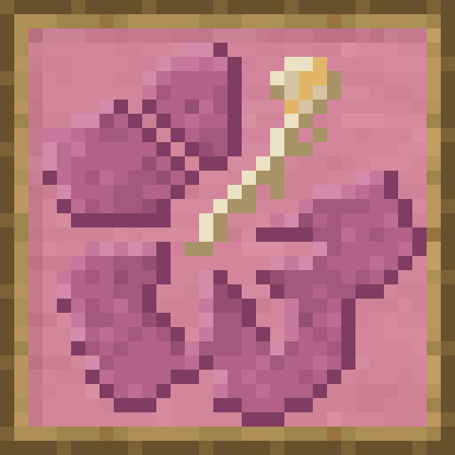
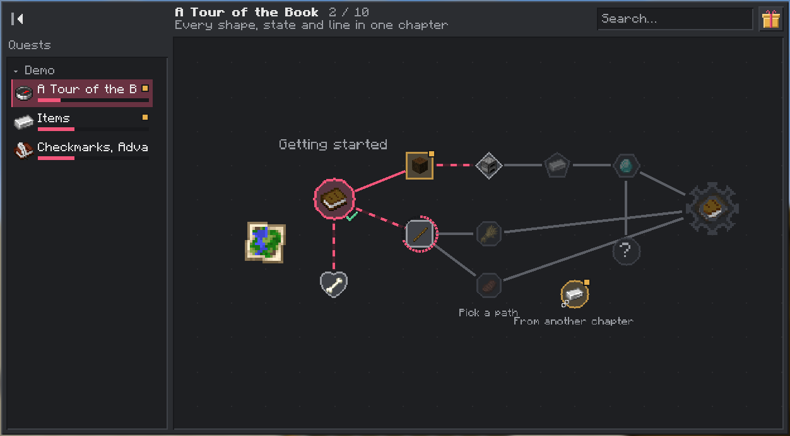
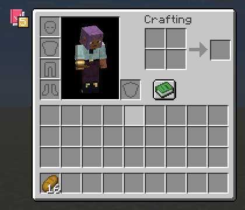
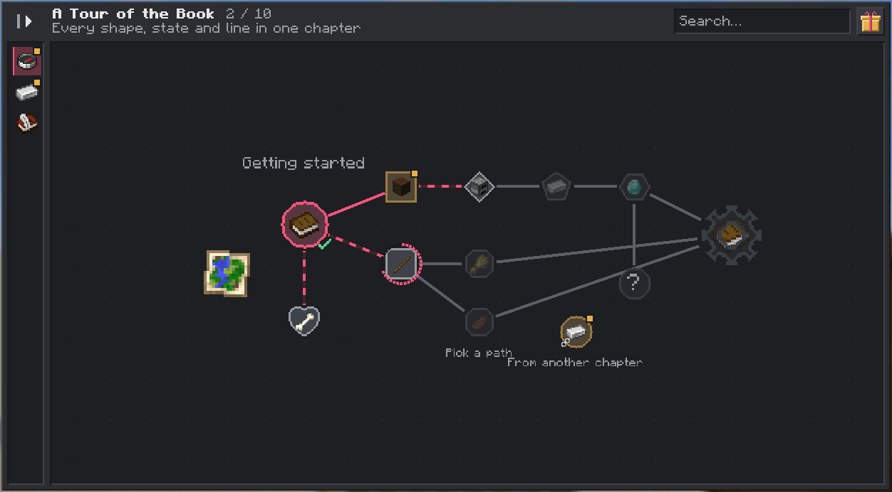
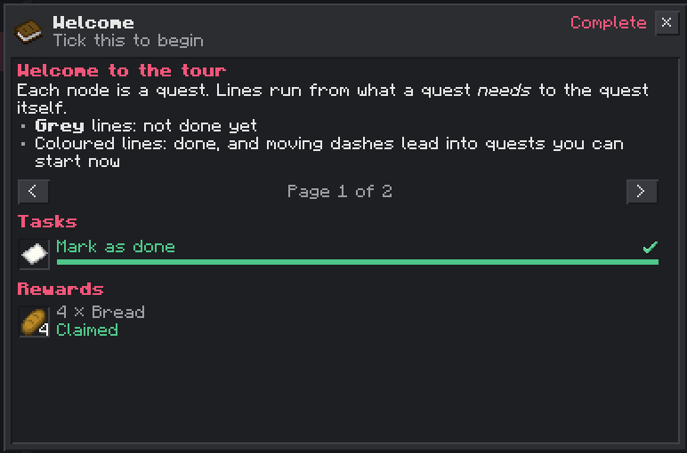
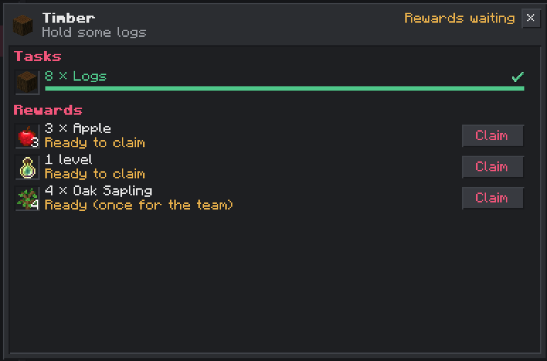
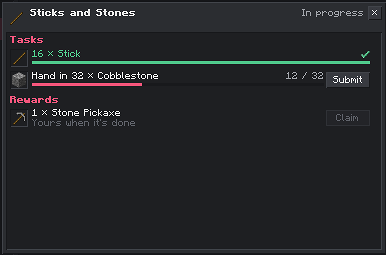
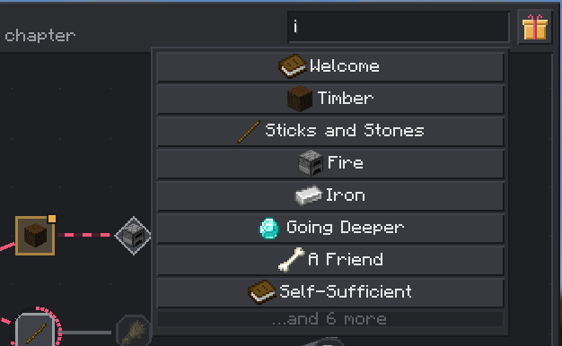
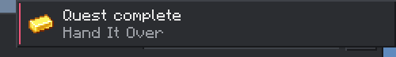

<p align="center"></p>

# Hibiscus Quests

A quest book for NeoForge (Minecraft 26.3) that any mod or modpack can fill: chapters drawn as maps of quests joined
by dependencies, tasks that track themselves or take items handed in, rewards claimed from the book, progress shared
by your team, and an in-game editor. Mods ship their quests as data, and packs restyle or replace them.

Needs [Hibiscus Lib](https://github.com/hibiscus-software/hibiscus-lib). With
[Hibiscus Teams](https://github.com/hibiscus-software/hibiscus-teams) installed, a party shares its progress; without
it, every player has their own.



> **In development.** The book works end to end (the files, the rules, the screens, saving and syncing); the in-game
> editor, more task and reward types, reward tables and the pinned-quests HUD are next.

## The book

Open it from the button by the inventory (its badge counts the rewards waiting for you), the "Open Quest Book" key
(unbound until you set it), or `/hibiscusquests open`. Chapters are down the left, in groups; each shows how far you are
and a gold dot where rewards wait. The map shows the chapter's quests joined by what they need: drag to pan, scroll to
zoom. A quest's node shows where you stand with it: locked, open, in progress (the ring), done with rewards waiting
(pulsing gold) or done.

<p>
</p>

Click a quest to open it: its description, its tasks (with Submit for items you hand in, and a tick box for steps you
only need to read), and its rewards, each with its own Claim button (or **Claim all** in the top bar). Items open their
recipes in JEI. Rewards are yours alone, or shared once by the team.

<p>
</p>
<p>
</p>

Search (Ctrl+F) finds quests by title, description or task. Tab and the arrow keys change chapter; Esc closes the quest,
then the book. A toast tells you when you finish a quest or chapter.



## For modpack authors

The book lives in `config/hibiscusquests/` (a world's `serverconfig/hibiscusquests/` wins when it exists):

```
config/hibiscusquests/
  data.snbt                  book settings
  chapter_groups.snbt        {groups: [{id: "basics", title: "The Basics", icon: "minecraft:crafting_table"}]}
  chapters/<chapter id>.snbt one chapter per file
```

The files are SNBT, with readable ids (`steel_ingot`, not random hex), so they can be written and reviewed by hand. A
small chapter:

```snbt
{
    id: "basics",
    group: "basics",
    title: "The Basics",
    icon: "minecraft:crafting_table",
    quests: [
        {id: "wood", title: "Punch a Tree", x: 0.0d, y: 0.0d,
         tasks: [{type: "item", tag: "minecraft:logs", count: 8L}],
         rewards: [{type: "item", item: "minecraft:apple", count: 4}]},
        {id: "table", title: "Crafting", x: 2.0d, y: 0.0d, dependencies: ["wood"],
         tasks: [{type: "item", item: "minecraft:crafting_table"}],
         rewards: [{type: "xp_levels", levels: 1}]}
    ]
}
```

`/hibiscusquests reload` reads the files again and reports any that don't parse (a broken file is skipped, never
overwritten). Chapters that mods ship can be replaced by a file with the same id, changed quest by quest with
`merge: true`, or hidden with `disabled_sources` in `data.snbt`. Every field is in [docs/API.md](docs/API.md).

- **Tasks:** `item` (hold the items, hand them in, or craft them), `checkmark`, `advancement` and `criterion` (any
  vanilla or modded advancement trigger, without touching players' advancements).
- **Rewards:** `item`, `xp`, `xp_levels` and `command`, per player or once per team, optionally claimed automatically.
- **Rules:** dependencies (`all`, `any`, `min`, and `one_of` for branching paths), chapters that open in order or after
  other chapters, optional and repeatable quests, and progress that counts before a quest unlocks.
- **Demo:** a small book showing each task type ships as a data pack; turn it on with `/datapack enable` (find it with
  `/datapack list`).

## For mod developers

Ship your quests in your jar under `data/<your mod id>/hibiscusquests/`, with no code and no compile dependency. A
`criterion` task turns any custom advancement trigger your mod already has into a quest task. For more, the API
(`hibiscusquests-api`) adds task and reward types, progress pushes, queries and events.

- [docs/API.md](docs/API.md): the file format, shipping chapters, criterion tasks, the API and its events
- [docs/DEPENDING.md](docs/DEPENDING.md): compiling against the API jar

## Commands

`/hibiscusquests`, or `/hquests`:

| Command | Who | |
|---|---|---|
| `open [quest]` | everyone | opens the book, on a quest (`chapter/quest`) if given |
| `claim_all` | everyone | claims every reward you can, except those left out of Claim all |
| `reload` | ops (`hibiscusquests.admin.reload`) | reads the pack's files again |
| `change_progress <player\|team> <reset\|complete> <quest\|chapter\|*>` | ops (`hibiscusquests.admin.change_progress`) | a quest is `chapter/quest`; players may be offline; a team is its short name or id |
| `debug <quest>` | ops (`hibiscusquests.admin.debug`) | why the quest is locked, and each task's progress (for someone else: `/execute as <player> run hquests debug ...`) |

The permission nodes default to op level 2; a permissions mod can grant them more finely.

## Configuration

Each player's own, `config/hibiscusquests-client.toml` (also under Mods > Hibiscus Quests > Config):

| Setting | Default | |
|---|---|---|
| `notifications.toasts` | true | toasts for completed quests and chapters, and rewards that arrive by themselves |
| `notifications.sounds` | true | sounds for the same, and for claims |
| `book.zoomSensitivity` | 1.0 | how far one step of the mouse wheel zooms |
| `book.reducedMotion` | false | no pulsing nodes or moving dashes |
| `book.chapterListCollapsed` | false | start with the chapter list as icons |

The server's, `config/hibiscusquests-server.toml` (a world's `syncedconfig/` copy wins):

| Setting | Default | |
|---|---|---|
| `progress.mode` | `TEAM` | `TEAM` (the player's team) or `PLAYER` (everyone on their own); `progress_mode` in `data.snbt` wins |
| `progress.teamChange` | `KEEP_WITH_TEAM` | on changing team: `KEEP_WITH_TEAM`, `COPY_TO_NEW_TEAM` (into a team with no progress) or `MERGE`; `team_change` in `data.snbt` wins |
| `tasks.itemScanInterval` | 10 | ticks between inventory checks for item tasks |
| `announcements.chapterCompletion` | false | announce completed chapters in chat |

## Building

```sh
./gradlew build runGameTestServer
```

Hibiscus Lib comes from GitHub Packages (a token with `read:packages` in `~/.gradle/gradle.properties`, see
[docs/DEPENDING.md](docs/DEPENDING.md)), or from a local checkout with `-Phibiscuslib_dir=../hibiscus-lib`. Releases:
[docs/RELEASING.md](docs/RELEASING.md). Changes: [CHANGELOG.md](CHANGELOG.md).

MIT licensed. FTB Quests was a behavioural reference only; none of its code, textures or text is used.
